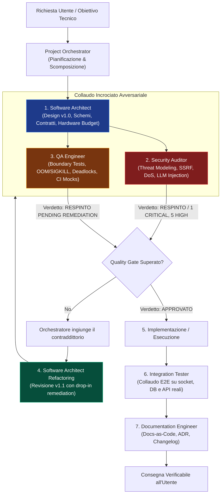

# 🚀 Engineering Team Subagents for Antigravity AI

[](plugin.json)
[](https://deepmind.google)
[](#il-protocollo-dialettico-ad-anello-chiuso)
[](LICENSE)

Una suite avanzata di **7 sub-agenti specializzati** per l'ingegneria del software in **Google Antigravity AI**.  
A differenza dei normali assistenti multi-agente che tendono al compiacimento passivo (*sycophancy*), questo team adotta un **protocollo dialettico ad anello chiuso con verifiche avversariali, quality gate formali e consapevolezza vincolata dell'hardware bare-metal**.

---

## 👥 La Squadra dei 7 Specialisti

| Agente | Ruolo | Responsabilità Chiave |
| :--- | :--- | :--- |
| **[`project-orchestrator`](agents/project-orchestrator.md)** | **Tech Lead & Coordinatore** | Governa il ciclo a 5 fasi, assegna i task in modo non ridondante, coordina i round di contraddittorio e blocca i rilasci se i quality gate non sono superati. |
| **[`software-architect`](agents/software-architect.md)** | **System Architect** | Progetta moduli disaccoppiati (SRP), contratti API tipizzati (OpenAPI, RFC 7807), admission control e vincoli di memoria fisica (bare-metal OS/hardware awareness). |
| **[`security-auditor`](agents/security-auditor.md)** | **Adversarial Security Engineer** | Threat modeling OWASP Top 10 Web e LLM, scansione SSRF con socket pinning, prevenzione indirect prompt injection, token smuggling e memory forensics. |
| **[`qa-engineer`](agents/qa-engineer.md)** | **Lead QA & Reliability Engineer** | Analisi dei failure modes su crash/OOM (Reaper pattern, Dead Letter Queue, PEL deadlock), boundary testing (0 byte, off-by-one) e testabilità in CI/CD (dependency inversion). |
| **[`integration-tester`](agents/integration-tester.md)** | **Collaudatore E2E & Rete** | Valida il dialogo reale tra Frontend, API, Redis/RabbitMQ, Database e Filesystem, simulando latenze di rete e testando la degradazione controllata. |
| **[`ui-ux-designer`](agents/ui-ux-designer.md)** | **Senior Frontend Design Engineer** | Crea layout moderni stile Linear/Stripe/Vercel: bento grid asimmetriche, dark mode profonda (`#09090b`), glassmorphism, micro-interazioni fluide con Tailwind, shadcn/ui e Framer Motion. |
| **[`documentation-engineer`](agents/documentation-engineer.md)** | **Ingegnere Documentale** | Custode del principio Docs-as-Code (zero invenzioni), redige Registri delle Decisioni Architetturali (ADR), changelog strutturati e guide operative chiare in italiano. |

---

## 🔄 Il Protocollo Dialettico ad Anello Chiuso

Per evitare il rilascio di architetture fragili o insicure, il team opera secondo un flusso di confronto costruttivo:



---

## 🚦 Standard dei Quality Gate & Verdetti

Tutti gli agenti di controllo (`security-auditor`, `qa-engineer`, `integration-tester`) sono obbligati a concludere la propria analisi con un verdetto formale non ambiguo:

- `[APPROVATO]`: Il componente rispetta integralmente gli standard di sicurezza, resilienza e copertura. Autorizza il passaggio alla fase successiva.
- `[APPROVATO CON RISERVA]`: Presenza di rilievi minori o non bloccanti (es. debito tecnico differibile tracciato nei task).
- `[RESPINTO]`: Presenza di vulnerabilità critiche/alte, rischio di memory leak, deadlock, regressioni o assenza di testabilità. Il rilascio è bloccato fino al refactoring documentato.

---

## 💻 Installazione & Utilizzo in Antigravity

### Installazione come Plugin
Clona o posiziona la directory del plugin nel percorso delle personalizzazioni utente di Antigravity:

```bash
mkdir -p ~/.gemini/config/plugins/
git clone https://github.com/tennet/antigravity-engineering-team.git ~/.gemini/config/plugins/engineering-team
```

Il plugin viene rilevato automaticamente dal Language Server di Antigravity ed è immediatamente utilizzabile in chat o richiamabile tramite gli agenti dedicati:

```bash
# Esempio: Invocazione diretta dall'ambiente Antigravity
@project-orchestrator coordina lo sviluppo del nuovo servizio di autenticazione
@security-auditor esegui un audit avversariale su questa API
@ui-ux-designer progetta la dashboard analitica in bento grid
```

---

## 📜 Licenza
Rilasciato sotto licenza [MIT](LICENSE).
