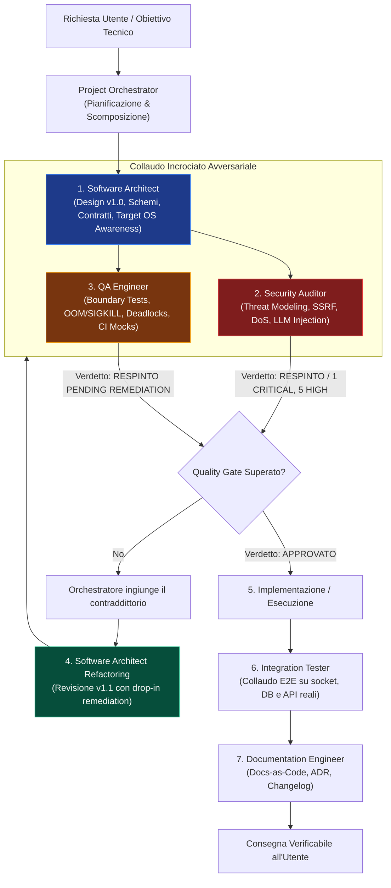

# 🚀 Engineering Team Subagents for Antigravity AI

[](plugin.json)
[](https://deepmind.google)
[](#-il-protocollo-dialettico-ad-anello-chiuso)
[](https://github.com/tennet)
[](LICENSE)

Una suite avanzata di **7 sub-agenti specializzati** per l'ingegneria del software in **Google Antigravity AI**, ideata e sviluppata da **Manuele Francescon** ([@tennet](https://github.com/tennet)).

A differenza dei normali assistenti multi-agente che tendono al compiacimento passivo (*sycophancy*), questo team adotta un **protocollo dialettico ad anello chiuso**: gli agenti non si limitano a generare codice, ma si mettono attivamente in discussione tramite verifiche avversariali, quality gate formali bloccanti e una rigorosa **consapevolezza dell'ambiente reale di esecuzione dell'utente** (macOS host, container Docker, VM o server Linux).

---

## ⚠️ Disclaimer & Architettura di Esecuzione

> [!IMPORTANT]
> **Distinzione tra Motore IA Cloud e Ambiente di Esecuzione Locale:**
> - **Chi elabora l'intelligenza artificiale (Cloud):** Antigravity AI e i modelli linguistici (Gemini) operano sui server e sull'infrastruttura Cloud di Google. Nessun modello LLM gigante viene fatto girare forzatamente sulla tua macchina per far funzionare Antigravity.
> - **Dove viene eseguito il codice sviluppato (Ambiente Locale / Server):** Gli script, le API, i container Docker, i database e le architetture progettati da questi sub-agenti sono destinati a girare sull'**ambiente target reale dell'utente** (es. un Mac Apple Silicon, una workstation Linux, una macchina virtuale o un cluster Docker/Kubernetes).
> 
> La *"consapevolezza dell'ambiente"* integrata negli agenti serve proprio a evitare che l'IA nel Cloud generi codice o comandi astratti incompatibili con il sistema operativo reale in cui andrai ad eseguire l'applicazione.

> [!NOTE]
> **Disclaimer di Responsabilità:**  
> Questo plugin è fornito "così com'è" (*AS IS*), senza garanzie di alcun tipo. Sebbene gli agenti integrino controlli di sicurezza (OWASP, threat modeling, anti-SSRF) e test di affidabilità, lo sviluppatore o l'amministratore di sistema è sempre tenuto a revisionare il codice prima del rilascio in produzione o prima di eseguire operazioni con impatto distruttivo sui dati.  
> Questo è un progetto indipendente della community creato da **Manuele Francescon** per Antigravity AI e non costituisce un prodotto ufficiale affiliato a Google LLC.

---

## 👥 La Squadra dei 7 Specialisti

| Agente | Ruolo | Responsabilità Chiave |
| :--- | :--- | :--- |
| **[`project-orchestrator`](agents/project-orchestrator.md)** | **Tech Lead & Coordinatore** | Governa il ciclo a 5 fasi, assegna i task in modo non ridondante, coordina i round di contraddittorio e blocca i rilasci se i quality gate non sono superati. |
| **[`software-architect`](agents/software-architect.md)** | **System Architect** | Progetta moduli disaccoppiati (SRP), contratti API tipizzati (OpenAPI, RFC 7807), admission control e vincoli di memoria fisica (consapevolezza dell'ambiente reale macOS vs Linux vs Docker). |
| **[`security-auditor`](agents/security-auditor.md)** | **Adversarial Security Engineer** | Threat modeling OWASP Top 10 Web e LLM, scansione SSRF con socket pinning, prevenzione indirect prompt injection, token smuggling e protezione credenziali. |
| **[`qa-engineer`](agents/qa-engineer.md)** | **Lead QA & Reliability Engineer** | Analisi dei failure modes su crash/OOM (Reaper pattern, Dead Letter Queue, PEL deadlock), boundary testing (0 byte, off-by-one) e testabilità in CI/CD (dependency inversion). |
| **[`integration-tester`](agents/integration-tester.md)** | **Collaudatore E2E & Rete** | Valida il dialogo reale tra Frontend, API, Redis/RabbitMQ, Database e Filesystem, simulando latenze di rete e testando la degradazione controllata. |
| **[`ui-ux-designer`](agents/ui-ux-designer.md)** | **Senior Frontend Design Engineer** | Crea layout moderni stile Linear/Stripe/Vercel: bento grid asimmetriche, dark mode profonda (`#09090b`), glassmorphism, micro-interazioni fluide con Tailwind, shadcn/ui e Framer Motion. |
| **[`documentation-engineer`](agents/documentation-engineer.md)** | **Ingegnere Documentale** | Custode del principio Docs-as-Code (zero invenzioni), redige Registri delle Decisioni Architetturali (ADR), changelog strutturati e guide operative chiare in italiano. |

---

## 🔄 Il Protocollo Dialettico ad Anello Chiuso

Per evitare il rilascio di architetture fragili o insicure, il team opera secondo un flusso di confronto costruttivo:



---

## 🚦 Standard dei Quality Gate & Verdetti

Tutti gli agenti di controllo (`security-auditor`, `qa-engineer`, `integration-tester`) sono obbligati a concludere la propria analisi con un verdetto formale non ambiguo:

- `[APPROVATO]`: Il componente rispetta integralmente gli standard di sicurezza, resilienza e copertura. Autorizza il passaggio alla fase successiva.
- `[APPROVATO CON RISERVA]`: Presenza di rilievi minori o non bloccanti (es. debito tecnico differibile tracciato nei task).
- `[RESPINTO]`: Presenza di vulnerabilità critiche/alte, rischio di memory leak, deadlock, regressioni o assenza di testabilità. Il rilascio è bloccato fino al refactoring documentato.

---

## 💻 Installazione & Utilizzo in Antigravity

### Installazione come Plugin
Clona o posiziona la directory del plugin nel percorso delle personalizzazioni utente di Antigravity:

```bash
mkdir -p ~/.gemini/config/plugins/
git clone https://github.com/tennet/antigravity-engineering-team.git ~/.gemini/config/plugins/engineering-team
```

Il plugin viene rilevato automaticamente dal Language Server di Antigravity ed è immediatamente utilizzabile in chat o richiamabile tramite gli agenti dedicati:

```bash
# Esempi di invocazione diretta in chat Antigravity
@project-orchestrator coordina lo sviluppo del nuovo servizio di autenticazione
@security-auditor esegui un audit avversariale e threat modeling su questa API
@qa-engineer progetta i test di failure recovery e boundary per questo modulo
@ui-ux-designer progetta la dashboard analitica moderna in bento grid
```

---

## 👨‍💻 Autore & Crediti
- **Autore:** [Manuele Francescon](https://github.com/tennet)
- **Repository Ufficiale:** [tennet/antigravity-engineering-team](https://github.com/tennet/antigravity-engineering-team)

---

## 📜 Licenza
Rilasciato sotto licenza [MIT](LICENSE). Copyright (c) 2026 Manuele Francescon.
