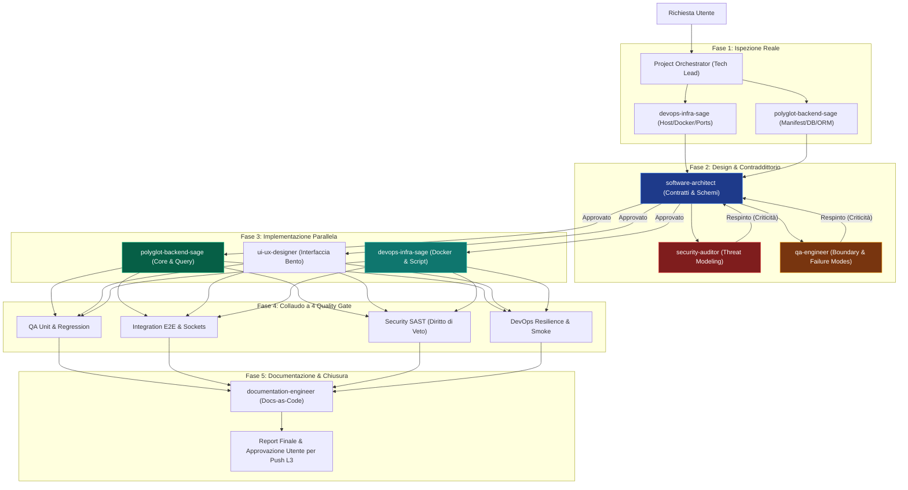

# 🚀 Engineering Team Subagents for Antigravity AI (v3.0.0)

[](plugin.json)
[](https://deepmind.google)
[](#-il-protocollo-dialettico-ad-anello-chiuso)
[](https://github.com/tennet)
[](LICENSE)

Una suite avanzata di **9 sub-agenti specializzati** per l'ingegneria del software in **Google Antigravity AI**, ideata e sviluppata da **Manuele Francescon** ([@tennet](https://github.com/tennet)).

A differenza dei normali assistenti multi-agente che tendono al compiacimento passivo (*sycophancy*), questo team adotta un **protocollo dialettico ad anello chiuso**: gli agenti non si limitano a generare codice, ma si mettono attivamente in discussione tramite verifiche avversariali, quality gate formali bloccanti, un **saggio polimorfico del backend** con specializzazione verticale su Laravel/PHP/MySQL e un **DevOps dedicato** per l'infrastruttura cross-platform (macOS Apple Silicon e Windows PC).

---

## ⚠️ Disclaimer & Architettura di Esecuzione

> [!IMPORTANT]
> **Distinzione tra Motore IA Cloud e Ambiente di Esecuzione Locale:**
> - **Chi elabora l'intelligenza artificiale (Cloud):** Antigravity AI e i modelli linguistici (Gemini) operano sui server e sull'infrastruttura Cloud di Google. Nessun modello LLM gigante viene fatto girare forzatamente sulla tua macchina per far funzionare Antigravity.
> - **Dove viene eseguito il codice sviluppato (Ambiente Locale / Server):** Gli script, le API, i container Docker, i database e le architetture progettati da questi sub-agenti sono destinati a girare sull'**ambiente target reale dell'utente** (es. un Mac Apple Silicon, una workstation Linux, una macchina virtuale o un cluster Docker/Kubernetes).
> 
> La *"consapevolezza dell'ambiente"* integrata negli agenti serve proprio a evitare che l'IA nel Cloud generi codice o comandi astratti incompatibili con il sistema operativo reale in cui andrai ad eseguire l'applicazione.

> [!NOTE]
> **Disclaimer di Responsabilità:**  
> Questo plugin è fornito "così com'è" (*AS IS*), senza garanzie di alcun tipo. Sebbene gli agenti integrino controlli di sicurezza (OWASP, threat modeling, anti-SSRF) e test di affidabilità, lo sviluppatore o l'amministratore di sistema è sempre tenuto a revisionare il codice prima del rilascio in produzione o prima di eseguire operazioni con impatto distruttivo sui dati.  
> Questo è un progetto indipendente della community creato da **Manuele Francescon** per Antigravity AI e non costituisce un prodotto ufficiale affiliato a Google LLC.

---

## 🧭 Guide & Documentazione Pratica
- 📖 **[VADEMECUM.md](VADEMECUM.md)**: **Guida pratica in linguaggio semplice** con il prontuario delle frasi esatte da scrivere in chat per ciascuno dei 9 agenti e i comandi quotidiani.
- 📘 **[docs/GUIDA_TECNICA_DETTAGLIATA.md](docs/GUIDA_TECNICA_DETTAGLIATA.md)**: **Specifiche architetturali approfondite**, diagrammi di flusso dei contratti e matrice dei quality gate.
- 📚 **[references/INDEX.md](references/INDEX.md)**: **Il Tomo della Saggezza Ingegneristica** — Raccolta dei 9 volumi canonici estratti dalla letteratura fondamentale mondiale (Kleppmann, Petrov, Google SRE, Zalewski, Feathers, Beck).

---

## 👥 La Squadra dei 9 Specialisti (Nomi Canonici & Alias Rapidi)

Ciascuno specialista può essere richiamato in chat indifferentemente con il suo **nome canonico formale** oppure con il suo **alias rapido** ispirato a una figura celebre della tecnologia moderna:

| Agente Canonico | Alias Rapido | Ruolo Specializzato | Responsabilità Chiave |
| :--- | :---: | :--- | :--- |
| **[`project-orchestrator`](agents/project-orchestrator.md)** | **[`@elon`](agents/elon.md)** | **Tech Lead & Coordinatore** | Governa il ciclo a 5 fasi, assegna i task secondo la matrice RACI, coordina il contraddittorio ed esige semafori verdi prima del rilascio. |
| **[`software-architect`](agents/software-architect.md)** | **[`@werner`](agents/werner.md)** | **System Architect** | Progetta moduli disaccoppiati (SRP), contratti API tipizzati (OpenAPI, RFC 7807), admission control e vincoli di memoria fisica (macOS vs Linux vs Windows). |
| **[`polyglot-backend-sage`](agents/polyglot-backend-sage.md)** | **[`@taylor`](agents/taylor.md)** | **Saggio Backend & DB Master** | Polimorfico (Laravel/Node/Python). Specializzazione verticale su Laravel 11/12, PHP 8.4+ ed Eloquent/MySQL: query senza N+1, transazioni ACID, indici compositi e Action pattern. |
| **[`ui-ux-designer`](agents/ui-ux-designer.md)** | **[`@steve`](agents/steve.md)** | **Senior Frontend Design Engineer** | Crea layout moderni stile Linear/Stripe/Vercel: bento grid asimmetriche, dark mode profonda (`#09090b`), glassmorphism, micro-interazioni fluide con Tailwind, shadcn/ui e Framer Motion. |
| **[`devops-infra-sage`](agents/devops-infra-sage.md)** | **[`@linus`](agents/linus.md)** | **DevOps & Infrastructure Sage** | Container Docker multi-arch (`buildx`), isolamento webroot, hardening Nginx/Apache, script bivalenti simmetrici Bash/PowerShell per coordinare 3 Mac e 1 PC Windows. |
| **[`qa-engineer`](agents/qa-engineer.md)** | **[`@carmack`](agents/carmack.md)** | **Lead QA & Reliability Engineer** | Analisi dei failure modes su crash/OOM (Reaper pattern, Dead Letter Queue, PEL deadlock), boundary testing (0 byte, off-by-one) e testabilità in CI/CD. |
| **[`integration-tester`](agents/integration-tester.md)** | **[`@rauch`](agents/rauch.md)** | **Collaudatore E2E & Rete** | Valida il dialogo reale tra Frontend, API, Redis/RabbitMQ, Database e Filesystem, simulando latenze di rete e testando la degradazione controllata. |
| **[`security-auditor`](agents/security-auditor.md)** | **[`@geohot`](agents/geohot.md)** | **Adversarial Security Engineer** | Threat modeling OWASP Top 10 Web e LLM, scansione SSRF con socket pinning, prevenzione indirect prompt injection, token smuggling e protezione credenziali. Possiede **Diritto di Veto**. |
| **[`documentation-engineer`](agents/documentation-engineer.md)** | **[`@guido`](agents/guido.md)** | **Ingegnere Documentale** | Custode del principio Docs-as-Code (zero invenzioni), redige Registri delle Decisioni Architetturali (ADR), changelog strutturati e guide operative chiare in italiano. |

---

## 🔄 Il Flusso di Lavoro a 5 Fasi (Workflow v3.0.0)



---

## 🚦 Standard dei Quality Gate & Verdetti

Tutti gli agenti di controllo (`security-auditor`, `qa-engineer`, `integration-tester`, `devops-infra-sage`) sono obbligati a concludere la propria analisi con un verdetto formale:

- `[APPROVATO]`: Il componente rispetta integralmente gli standard di sicurezza, resilienza e copertura. Autorizza il passaggio alla fase successiva.
- `[APPROVATO CON RISERVA]`: Presenza di rilievi minori o non bloccanti (es. debito tecnico differibile tracciato nei task).
- `[RESPINTO]`: Presenza di vulnerabilità critiche/alte, rischio di memory leak, deadlock, regressioni o assenza di testabilità. Il rilascio è bloccato fino al refactoring documentato.

---

## 💻 Installazione & Utilizzo in Antigravity

```bash
mkdir -p ~/.gemini/config/plugins/
git clone https://github.com/tennet/antigravity-engineering-team.git ~/.gemini/config/plugins/engineering-team
```

In chat Antigravity:
```text
@project-orchestrator avvia lo sviluppo completo per il nuovo modulo di autenticazione
@polyglot-backend-sage ottimizza le query Eloquent e le migrazioni per questo modello
@devops-infra-sage configura il docker-compose multi-arch e gli script di deploy
@ui-ux-designer progetta la nuova interfaccia a schede Bento Grid
@security-auditor esegui un audit avversariale su questa pull request
```

---

## 📜 Licenza
Rilasciato sotto licenza [MIT](LICENSE). Copyright (c) 2026 Manuele Francescon.
