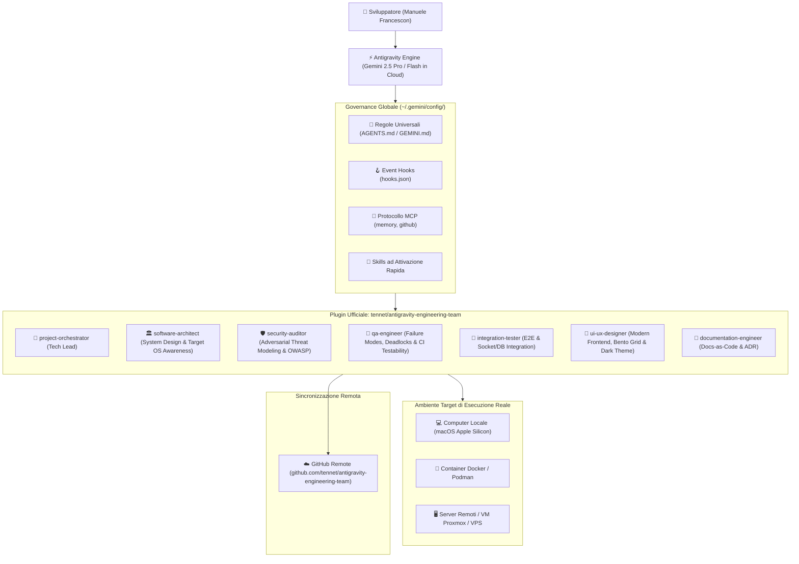
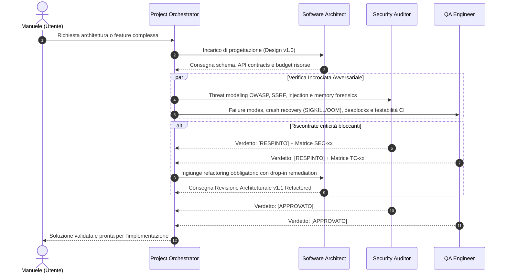

# 📘 Guida Tecnica Dettagliata: Architettura & Ecosistema Antigravity

> **Autore:** [Manuele Francescon](https://github.com/tennet)  
> **Versione:** 2.1.1 — Suite Sub-Agenti & Protocollo Dialettico  
> **Repository Ufficiale:** [tennet/antigravity-engineering-team](https://github.com/tennet/antigravity-engineering-team)  
> **Ambiente Operativo:** Google Antigravity AI | macOS Apple Silicon / Linux / Docker | Node.js v26.8.1 | Python 3.15.0

---

## 1. Mappa Architetturale Completa

L'ambiente separa nettamente il motore di intelligenza artificiale (**Cloud Gemini**) dalla gestione operativa locale dei progetti e delle configurazioni.



---

## 2. Directory Structure del Plugin

```text
~/.gemini/config/plugins/engineering-team/
├── .gitignore                     # Protezione credenziali e file OS
├── LICENSE                        # Licenza MIT (Copyright Manuele Francescon)
├── README.md                      # Presentazione, disclaimer, matrice ruoli e badge
├── VADEMECUM.md                   # Prontuario pratico in linguaggio semplice
├── plugin.json                    # Manifest del plugin (v2.1.1)
├── agents/                        # I 7 Sub-Agenti Specializzati
│   ├── documentation-engineer.md
│   ├── integration-tester.md
│   ├── project-orchestrator.md
│   ├── qa-engineer.md
│   ├── security-auditor.md
│   ├── software-architect.md
│   └── ui-ux-designer.md
└── docs/                          # Documentazione Tecnica di Dettaglio
    └── GUIDA_TECNICA_DETTAGLIATA.md
```

---

## 3. Il Ciclo di Contraddittorio (Anti-Sycophancy)

Nei sistemi multi-agente convenzionali, gli assistenti tendono ad approvare acriticamente il lavoro precedente (*sycophancy*).  
La suite **`antigravity-engineering-team`** introduce una regola di condotta avversariale obbligatoria:



---

## 4. Matrice dei Quality Gate Formali

Tutti i collaudatori e controllori di sicurezza operano con esiti vincolanti:

| Verdetto | Condizione | Impatto sul Flusso |
| :--- | :--- | :--- |
| **`[APPROVATO]`** | Zero vulnerabilità critiche o alte; testabilità e resilienza garantite al 100%. | Autorizza l'avanzamento allo sviluppo o al rilascio su Git. |
| **`[APPROVATO CON RISERVA]`** | Solo rilievi minori o di debito differibile (severità Low/Medium non bloccante). | Richiede tracking formale nei task, ma non blocca l'implementazione. |
| **`[RESPINTO]`** | Rilevata almeno una vulnerabilità Critical/High, rischio crashloop, leak di risorse o assenza di mock per CI. | **Blocco totale del rilascio**: il compito torna all'Architetto/Sviluppatore per la revisione. |

---

## 5. Manutenzione e Sviluppo Continuo
Per aggiornare il plugin o sincronizzare modifiche:
```bash
cd ~/.gemini/config/plugins/engineering-team
git status
git add .
git commit -m "feat(scope): descrizione della modifica"
git push origin main
```
