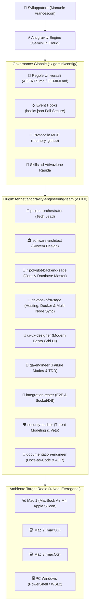

# 📘 Guida Tecnica Dettagliata: Architettura & Ecosistema Antigravity v3.0.0

> **Autore:** [Manuele Francescon](https://github.com/tennet)  
> **Versione:** 3.0.0 — Suite Sub-Agenti a 9 Specialisti, Saggio Polimorfico & DevOps Multi-Node  
> **Repository Ufficiale:** [tennet/antigravity-engineering-team](https://github.com/tennet/antigravity-engineering-team)  
> **Ambiente Operativo:** Google Antigravity AI | macOS Apple Silicon / Windows 11 / Linux | Node.js | Python | PHP 8.4+

---

## 1. Mappa Architetturale Completa

L'ambiente separa nettamente il motore di intelligenza artificiale (**Cloud Gemini**) dalla gestione operativa locale dei progetti e delle configurazioni.



---

## 2. Directory Structure del Plugin (v3.0.0)

```text
~/.gemini/config/plugins/engineering-team/
├── .gitignore                     # Protezione credenziali e file OS
├── LICENSE                        # Licenza MIT (Copyright Manuele Francescon)
├── README.md                      # Presentazione v3.0.0, disclaimer, matrice ruoli e badge
├── VADEMECUM.md                   # Prontuario pratico per tutti i 9 agenti
├── plugin.json                    # Manifest del plugin (v3.0.0)
├── agents/                        # I 9 Sub-Agenti Specializzati
│   ├── devops-infra-sage.md       # [NUOVO] DevOps, hosting, Docker e sync multipiattaforma
│   ├── documentation-engineer.md
│   ├── integration-tester.md
│   ├── polyglot-backend-sage.md   # [NUOVO] Saggio polimorfico (Laravel/Node/Python/MySQL)
│   ├── project-orchestrator.md
│   ├── qa-engineer.md
│   ├── security-auditor.md
│   ├── software-architect.md
│   └── ui-ux-designer.md
└── docs/                          # Documentazione Tecnica di Dettaglio
    └── GUIDA_TECNICA_DETTAGLIATA.md
```

---

## 3. Il Protocollo Deterministico del Sub-Agente Polimorfico

`polyglot-backend-sage` non è un generico assistente, ma adotta il **Deterministic Manifest Detection Protocol**:

| Stack Rilevato | Manifest Trigger | Specializzazione Applicata |
| :--- | :--- | :--- |
| **LARAVEL_MODERN** | `composer.json` con `laravel/framework` | PHP 8.4+, Laravel 11/12 lean skeleton, Action pattern, prevenzione $N+1$ con `Model::with()`, indici compositi MySQL/SQLite, `DB::transaction()`. |
| **PHP_VANILLA** | `composer.json` senza Laravel | PHP 8.4+, architettura PSR-4, PSR-7/15, typed constants, property hooks. |
| **NODE_TYPESCRIPT** | `package.json` + `tsconfig.json` | Strict TypeScript, validazione runtime Zod, Fastify/Express/Nest, async/await privo di unhandled rejections. |
| **PYTHON_MODERN** | `pyproject.toml` / `requirements.txt` | Python 3.12+, FastAPI, Pydantic v2, SQLAlchemy 2.0 con type hints completi. |

---

## 4. Architettura di Sincronizzazione Multi-Nodo (3 Mac + 1 PC)

Progettata da `devops-infra-sage` per evitare i fallimenti dello storage cloud consumer non strutturato:

1. **Separazione Netta**:
   - **Control Plane (Configurazioni, Skills, Agenti)**: sincronizzato tramite il repository Git `tennet/antigravity-engineering-team` con gestione CRLF normalizzata via `.gitattributes`.
   - **Data Plane (Memoria MCP & Knowledge Graph)**: file isolati per singolo nodo (`memory_mac_m4.jsonl`, `memory_pc_win.jsonl`) con unificazione automatica all'avvio priva di collisioni o race condition.
2. **Scripting Bivalente Simmetrico**:
   - `sync.sh` per i nodi macOS (POSIX zsh/bash compatibile con Apple Silicon).
   - `sync.ps1` per il nodo Windows (PowerShell nativo, gestione automatica delle Junctions `mklink /J` senza privilegi amministratore UAC).
